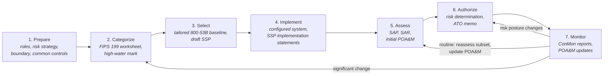

# The RMF in plain language

This is my own summary of the Risk Management Framework, written as study notes. It covers
**NIST SP 800-37 Revision 2** (December 2018), which is still the current revision as of
November 2026. It is not a substitute for the publication. For the actual tasks, roles, and
wording, read the source:

- NIST SP 800-37 Rev. 2: <https://csrc.nist.gov/pubs/sp/800/37/r2/final>
- NIST SP 800-53 Rev. 5 (controls; current release 5.2.0, Aug 2025): <https://csrc.nist.gov/pubs/sp/800/53/r5/upd1/final>
- NIST SP 800-53B (control baselines): <https://csrc.nist.gov/pubs/sp/800/53/b/upd1/final>
- NIST SP 800-53A Rev. 5 (assessment procedures): <https://csrc.nist.gov/pubs/sp/800/53/a/r5/final>
- FIPS 199 (security categorization): <https://csrc.nist.gov/pubs/fips/199/final>
- FIPS 200 (minimum security requirements): <https://csrc.nist.gov/pubs/fips/200/final>
- NIST SP 800-137 (continuous monitoring): <https://csrc.nist.gov/pubs/sp/800/137/final>

Rev. 2 has **seven steps**. It added *Prepare* in front of the six steps from Rev. 1. The steps
go in order the first time through, but the RMF is a loop: monitoring results feed back into
earlier steps, and a significant change to the system can send you back to Categorize or Select.

The source for this diagram is [`../diagrams/rmf_process.mmd`](../diagrams/rmf_process.mmd).

---

## 1. Prepare

**In plain terms:** Set things up so the rest of the process isn't improvised. At the
organization level, decide who owns risk decisions, how much risk leadership will accept, and
which common controls (shared services such as enterprise identity or physical security) systems
can inherit. At the system level, define what the system is for, where its boundary is, who its
stakeholders are, and what assets and data it handles.

**Typical outputs**
- Named roles: authorizing official (AO), system owner, ISSO/ISSM, control assessor
- Organizational risk management strategy and risk tolerance statement
- List of common controls and who provides them
- System boundary and an initial asset and data-flow inventory
- Initial risk assessment

## 2. Categorize

**In plain terms:** Work out how bad it would be if the system's information lost
confidentiality, integrity, or availability. Rate each information type LOW, MODERATE, or HIGH
for each of the three objectives (FIPS 199). The system takes the highest rating for each
objective, and the overall level is the highest of those three (the "high-water mark" in
FIPS 200). That overall level picks the starting control baseline.

**Typical outputs**
- Information types list (SP 800-60 is the usual reference)
- FIPS 199 categorization worksheet, reviewed and approved by the AO or designee
- System description that goes into the SSP

`src/categorize.py` in this repo does the roll-up math. The Acme example ends up at **Moderate**.

> DoD note: DoD systems follow DoDI 8510.01 and categorize with CNSSI 1253, which keeps the
> separate C/I/A values instead of collapsing them to one level. This repo uses the plain
> NIST/FIPS approach.

## 3. Select

**In plain terms:** Pick the controls. Start from the SP 800-53B baseline that matches the
categorization, then tailor it: scope out what doesn't apply, mark what's inherited, add controls
for specific threats, and set the organization-defined parameters (for example, how many days
before an inactive account is disabled). Also decide how each control will be monitored over time.

**Typical outputs**
- Tailored control baseline with a rationale for each change
- Control allocation (system-specific, hybrid, or inherited)
- Draft System Security Plan (SSP)
- Continuous monitoring strategy for the system

## 4. Implement

**In plain terms:** Put the controls in place and write down *how* each one is actually done,
specific enough that an assessor can test it. Update the SSP so it matches reality, not the plan.

**Typical outputs**
- Configured system (hardened baselines, for example against a STIG or CIS benchmark)
- SSP with implementation statements for every control
- Supporting policies, procedures, and configuration records

## 5. Assess

**In plain terms:** An independent assessor tests whether the controls are implemented correctly,
working as intended, and producing the desired outcome. They examine documents, interview
people, and test the system (SP 800-53A describes these methods). Anything that falls short
becomes a finding. The system team can fix some findings right away; the rest go on a POA&M.

**Typical outputs**
- Security Assessment Plan (SAP)
- Security Assessment Report (SAR) with findings and risk ratings
- Initial remediation actions
- Plan of Action and Milestones (POA&M)

## 6. Authorize

**In plain terms:** A senior official (the AO) looks at the package (SSP, SAR, POA&M, and the
risk summary) and decides whether operating the system is an acceptable risk to the
organization. It's a business decision backed by the evidence, not a pass/fail score. Rev. 2
names several decision types, including authorization to operate, authorization to use, common
control authorization, and denial of authorization.

**Typical outputs**
- Authorization package (SSP + SAR + POA&M + executive summary)
- Risk determination and a risk response for each open item
- Authorization decision document (the "ATO memo") with terms, conditions, and termination
  date or ongoing-authorization criteria

## 7. Monitor

**In plain terms:** Keep watching after the ATO. Assess a subset of controls on a schedule, track
changes to the system and its environment, keep the POA&M current, report status to the AO, and
re-authorize when the risk picture changes enough to warrant it. With good enough monitoring an
organization can move to *ongoing authorization* instead of a full reauthorization every few years.

**Typical outputs**
- Continuous monitoring (ConMon) plan and recurring reports
- Updated SSP, SAR, and POA&M
- Security impact analyses for proposed changes
- Ongoing risk determinations, and a decommissioning plan when the system retires

---

## Where the templates fit

| Step | Template in this repo |
|---|---|
| Categorize | [`templates/fips199_categorization.md`](../templates/fips199_categorization.md) |
| Select / Implement | [`templates/ssp_outline.md`](../templates/ssp_outline.md) |
| Assess | [`templates/sar.md`](../templates/sar.md), [`templates/poam.csv`](../templates/poam.csv) |
| Authorize | [`templates/ato_memo.md`](../templates/ato_memo.md) |
| Monitor | [`templates/conmon_plan.md`](../templates/conmon_plan.md), [`templates/poam.csv`](../templates/poam.csv) |
